<p align="center">
  
</p>

[](https://github.com/arooj1/website-governance-audit/actions/workflows/ci.yml) [](LICENSE) [](#manners)

# Website governance audit

Your website is already making legal promises.

Every cookie it drops, every testimonial it quotes, every "13+ years" in a headline is a representation to the public. Somebody's law covers each one. Most owners have never read what their site says on their behalf.

This repo is a Claude skill plus a scanner that reads it for you. It walks in like a first-time visitor who has agreed to nothing, writes down everything the site does, and checks it clause by clause against the laws that actually apply.

It's not a cookie-banner generator. It's a governance review with receipts.

> A governance review against published laws and standards, not legal advice.

## What a finding looks like

Every finding carries five things, so nobody has to take the report on faith:

| Part | What it holds |
| --- | --- |
| What we saw | The evidence, with the page URL, quoted where text is the evidence |
| The clause | Law, section, and a link to the official text |
| Why it applies here | The trigger, from the owner's country and the visitors' regions |
| The fix | Wording or code you can paste |
| Effort | Minutes, hours or days |

The report also lists what's already right, the facts only the owner can confirm, and laws that are coming but not here yet.

## Reachable everywhere is not governed everywhere

<p align="center">
  
</p>

A website loads in every country. That doesn't put it under every country's law.

Canadian law applies to a Canadian owner. The EU GDPR applies to that owner only if the site **offers** services to people in the EU or **monitors** them, for example with tracking cookies. The EU AI Act's disclosure rule applies when AI-generated **output is used in the EU**. So the skill gives every framework one of four statuses, with the reason:

- **Applies.** The trigger is met on the evidence.
- **Likely applies.** It depends on a fact the owner must confirm.
- **Not triggered.** And here's exactly what would trigger it.
- **Best practice only.** No legal hook, but the sensible standard.

"Not triggered" is the most useful line in most reports. It tells you which shiny new tracking script would quietly bring the GDPR along with it.

## Tried on my own site first

Before pointing this at anyone else, I ran it on [aroojqureshi.com](https://aroojqureshi.com). Nine findings. Eight fixed the same afternoon, and the ninth closed on confirmation. Then a second scan of the live site checked the fixes.

| Check | First scan | After the fixes |
| --- | --- | --- |
| Cookies before consent | 0 | 0 |
| Privacy notice | None | Published and linked |
| AI-generated hero video | Unlabelled | Labelled, with an AI-use line in the footer |
| Plain http | Served the site | Redirects to https |
| Security headers | 0 of 5 | 5 of 5 |
| Automated accessibility violations | 4 | 0 |

The most uncomfortable finding was my own headline. "13+ years of production AI in regulated industries" counted years that weren't in regulated industries. Fixing it took ten minutes. Admitting it took slightly longer.

## Frameworks in the clause library

| Region | Frameworks |
| --- | --- |
| Canada | PIPEDA, Quebec Law 25, CASL, Competition Act (claims and testimonials), Copyright Act, AODA |
| EU | GDPR, ePrivacy Directive (cookies), EU AI Act Art. 50 (AI-content transparency), European Accessibility Act |
| UK | UK GDPR, PECR as amended by the Data (Use and Access) Act 2025 |
| US | FTC Act s. 5, Endorsement Guides (16 CFR 255), Consumer Reviews and Testimonials Rule (16 CFR 465), CCPA/CPRA, COPPA, CAN-SPAM, ADA (risk only) |
| Standards | WCAG 2.2 AA, C2PA content credentials, RFC 9116 security.txt, AI-crawler policy |

Each library file carries a "Last verified" date. Laws move, so the library is watched (next section).

## Keeping the law current

A clause library is only as good as its last check. Three layers keep it honest:

1. **A source register.** [`sources.json`](skill/website-governance-audit/references/sources.json) ties every clause entry to its official source (Justice Laws, EUR-Lex, eCFR, legislation.gov.uk, W3C, LEGISinfo) and records the change signal at the last human review: "last amended on", the latest amendment date, the current consolidated version, a bill's stage.
2. **A weekly watch.** Every Monday, the [Law watch](.github/workflows/law-watch.yml) action reads each source's signal and opens a `law-watch` issue when one has moved, when a review is older than 180 days, when a watched date arrives (like the EU AI Act's next deadline), or when it can no longer read a source. A blind watcher raises its hand; it doesn't stay quiet.
3. **A person approves every change.** Once a month, a Claude task turns open `law-watch` issues into draft pull requests that update the affected entries, citing the official text. Nothing merges without a human review.

Two sources don't offer a readable signal: LégisQuébec refuses automated requests, and Ontario's e-Laws draws its text with JavaScript. The watcher doesn't work around either; they get a human re-read every 90 days instead.

What this can't catch: court rulings and regulator guidance (the Privacy Commissioner, the CAI, the EDPB, the ICO, the FTC) change meaning without changing the text. Those get a scheduled quarterly review. If you rely on an entry for something that matters, read the source it links to.

## How it works

1. **Intake.** Where the owner is, how big the business is, who visits, what data comes in, and which media are AI-generated.
2. **Scan.** [`scan.mjs`](skill/website-governance-audit/scripts/scan.mjs) opens the site in a fresh browser and clicks nothing. It records cookies and storage set before consent, every third-party host, security headers, policy pages and their text, forms and their consent wording, media and embeds, AI-content labels, testimonials, structured data, crawler files, first-visit screenshots, and axe-core accessibility results.
3. **Applicability.** [`jurisdictions.md`](skill/website-governance-audit/references/jurisdictions.md) decides which laws apply, from origin and audience.
4. **Checks.** The [clause libraries](skill/website-governance-audit/references) test the evidence.
5. **Report.** Findings are written as data ([`report-schema.md`](skill/website-governance-audit/references/report-schema.md)) and rendered by [`render-report.mjs`](skill/website-governance-audit/scripts/render-report.mjs) into one self-contained page: colour-coded tables, the three fixes that matter most at the top, passes as well as failures. It reads well on a phone and prints cleanly. See the [sample report data](examples/aroojqureshi.com.report.json) for aroojqureshi.com.

## Use it

**As a Claude skill.** Copy [`skill/website-governance-audit/`](skill/website-governance-audit) into your skills folder, or upload it as a skill. Then ask: *"Run a website governance audit on https://example.com."*

**Run the scanner yourself.**

```bash
npm ci
npx playwright install chromium
npm run scan -- https://example.com --out evidence/example.com --max-pages 12
npm run report -- examples/aroojqureshi.com.report.json --out report.html
```

**Run it in GitHub Actions.** Actions → **Governance scan** → *Run workflow*, then enter one or more URLs, comma-separated. The evidence is uploaded as an artifact and kept for 7 days.

## Manners

An auditor that ignores the rules it checks would be a bit rich.

- **It knocks.** The scanner says who it is in its user agent (`website-governance-audit/<version>`) and obeys robots.txt. If a site blocks crawlers, the scan stops. It runs only with the owner's permission (`--owner-authorized`).
- **It agrees to nothing.** The first-visit scan never accepts a consent banner, submits a form or creates an account.
- **It doesn't overclaim.** The skill never says a site "is compliant". It reports what the evidence shows against each clause.
- **It minds its own business.** Scan sites you own or have permission to review. Don't publish findings about someone else's site without their OK.
- **Even the images behave.** The animations in this README play once and settle inside five seconds (WCAG 2.2.2). A governance repo with an endlessly looping banner would be a little embarrassing.

## Licence

Code and skill: MIT © 2026 Arooj Qureshi.

The README images embed subsets of Inter Tight, Caveat and JetBrains Mono under the SIL Open Font License 1.1; the licence files are in [`assets/banner/`](assets/banner). Rebuild the images with `python3 assets/banner/build.py` and `python3 assets/banner/build_scope.py`.
